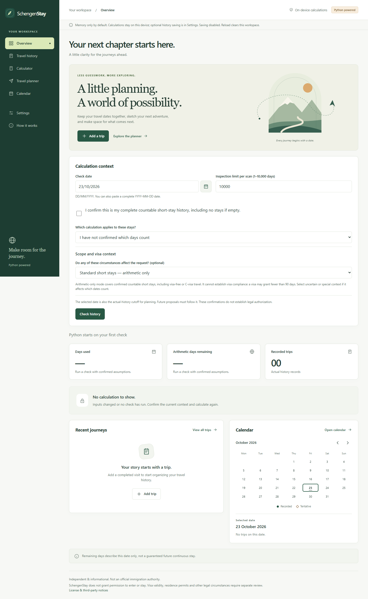

# SchengenStay

A free, privacy-conscious Schengen travel calculator and planner. Real Python
runs in your browser to explain the standard **90 days in any rolling 180 days**
rule, including both arrival and departure days.

**[Live application](https://mr-egr.github.io/SchengenStay/)** · Free to use, no account required.



## What it does

- Organizes completed and ongoing stays with accessible keyboard/calendar date entry.
- Checks every relevant historical day and explains the first arithmetic violation.
- Evaluates fixed trips, finds a bounded maximum continuous stay and earliest
  entry, and compares independent scenarios without changing actual history.
- Keeps missing information, unsupported legal context and computational limits
  distinct from successful calculations.
- Provides seven responsive screens, English/Russian, light/dark themes, and
  optional local history saving with explicit consent and deletion.

Travel records are processed locally. No accounts, analytics, ads, paid APIs or
application backend. Runtime downloads still contact the hosting/CDN providers.
See the [mobile screenshot](docs/images/overview-mobile.png).

## Engineering

**Python 3.12+ · Pyodide / WebAssembly · Web Workers · HTML/CSS · vanilla JavaScript**

A validated JSON bridge connects the UI to one pure-Python engine; there is no
second day-rule implementation in JavaScript. Immutable models, bounded searches,
worker cancellation and stale-response protection keep results interpretable.
GitHub Actions checks Windows and Ubuntu before publishing the tested static artifact.

Verification includes **411 Python tests**, **18 Hypothesis properties**, **36
frontend unit tests**, real-browser journeys, and **99 CPython/Pyodide parity
comparisons**. Six published Commission examples and twelve live-calculator cases
were checked in Stage 7. Exact coverage and limitations are in the
[QA record](docs/RELEASE_READINESS.md).

## Run locally

Python 3.12+; from the repository root:

```sh
python -m pip install -r requirements-dev.txt
python -m pip install --no-build-isolation --no-deps -e .
python -m http.server 8765 --bind 127.0.0.1 --directory web
```

Open [localhost:8765](http://127.0.0.1:8765). Use a virtual environment; see
[platform-specific setup](CONTRIBUTING.md). Initial Python loading needs internet access.

```sh
python -m pytest -q
ruff check .
python -m pip check
node --test tests/frontend/*.test.mjs
python scripts/build_browser.py --check
python scripts/check_docs.py
```

## Documentation and scope

[Architecture & APIs](ARCHITECTURE.md) · [Calculation rules](CALCULATION_RULES.md) ·
[Legal limitations](docs/LEGAL_CONTEXT.md) · [Browser guide](docs/FRONTEND.md) ·
[Deployment & attribution](docs/DEPLOYMENT.md) · [Progress](PROGRESS.md) ·
[Roadmap](ROADMAP.md)

SchengenStay is independent and informational. It **does not grant permission to
enter or stay**, assess visa validity, or adjudicate residence and other special
legal circumstances. Arithmetic days remaining are not a guaranteed future stay.
JSON import/export and guaranteed offline use are not implemented. Physical-device,
Apple Safari and screen-reader validation remain open.

Original project code is [MIT licensed](LICENSE), copyright 2026 Egor Kibishev.
[Third-party components retain their own licenses](web/THIRD_PARTY_NOTICES.txt).
