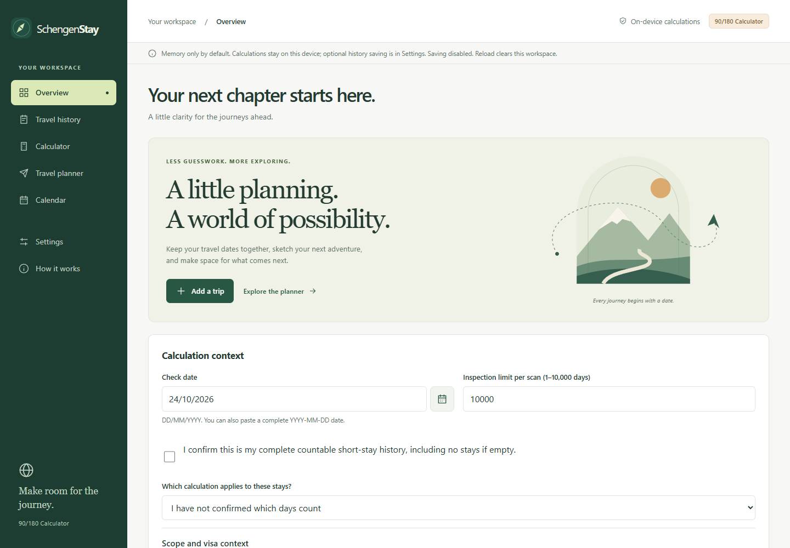
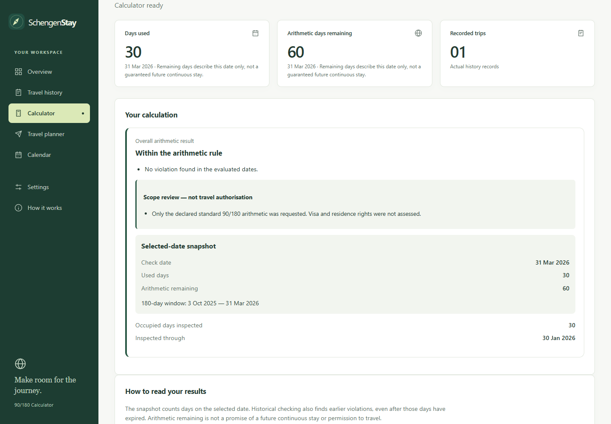
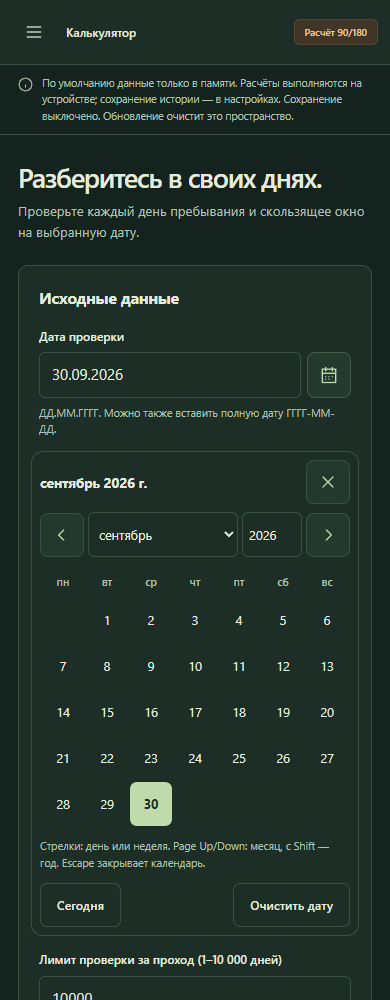
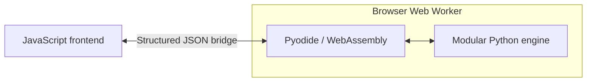

# SchengenStay

A free Schengen travel calculator and planner that helps travellers check their stay history against the rolling 90/180-day rule.

**[Live Demo](https://mr-egr.github.io/SchengenStay/)** · **[Source Code](https://github.com/Mr-Egr/SchengenStay)**

Every new travel date changes which past days fall inside the previous 180 days.
SchengenStay replaces manual counting with daily history checks and bounded trip
planning, including both arrival and departure dates.

> **Informational arithmetic only.** SchengenStay does not determine visa or
> residence permission, grant permission to enter or stay, or provide official EU
> legal guidance. Remaining arithmetic days are not a guaranteed future stay.

## Features

- **Rolling 90/180 calculations:** counts unique occupied days in each inclusive
  180-day window, including leap years and calendar boundaries.
- **Travel history validation:** checks dates, duplicates and overlaps; supports
  completed stays and ongoing stays with an explicit check date and confirmation.
- **Violation detection:** checks every relevant historical day and explains the
  first violation, its rolling window and day count. Missing or unsupported
  context stays distinct from a successful arithmetic result.
- **Travel planning:** evaluates fixed trips, finds a bounded maximum continuous
  stay or earliest entry, and compares scenarios without changing actual history.
- **Bilingual responsive interface:** English/Russian, light/dark themes, keyboard
  and calendar date entry, and optional local history saving with explicit consent.

## Screenshots

Actual application captures, not mockups. The overview starts with no travel data.



<details>
<summary>See a real calculation and the Russian mobile date picker</summary>

Synthetic example: 1–30 January 2026, checked on 31 March 2026. The browser's
Python engine reports 30 used days and 60 remaining arithmetic days.



Russian interface in dark theme at a mobile-sized viewport. Editing the date
invalidates the previous result; the open picker is shown before recalculation.



[Capture provenance and limitations](docs/images/README.md).

</details>

## Architecture

**Python 3.12+ · HTML/CSS · vanilla JavaScript · Pyodide / WebAssembly · Web Worker**

A modular, standard-library-only Python package owns validation, date arithmetic,
compliance checks and planning. The JavaScript frontend manages forms and state.
A structured JSON bridge sends requests to the same Python package running through
Pyodide in a Web Worker; JavaScript does not duplicate the 90/180 calculation rules.



Immutable models, six explicit result statuses, bounded searches and stale-response
protection keep results interpretable. The application is statically hosted on
GitHub Pages with **no dedicated backend**. See [architecture and public APIs](ARCHITECTURE.md)
and the [browser integration guide](docs/FRONTEND.md).

## Testing & Quality

- **pytest and Hypothesis:** unit, boundary and property-based tests, including
  independent date-set/search oracles and recorded official-example regressions.
- **Frontend tests:** Node's test runner checks validation, localization, storage,
  consent and asynchronous worker behavior.
- **Browser integration:** Playwright exercises real UI journeys, date entry,
  accessibility basics and full-result **CPython/Pyodide parity** for public APIs.
- **Windows and Ubuntu CI:** [GitHub Actions](https://github.com/Mr-Egr/SchengenStay/actions/workflows/ci.yml)
  runs Python, frontend and Chromium suites, Ruff, dependency consistency, source
  archive, documentation and publication checks.

The [QA record](docs/RELEASE_READINESS.md) distinguishes published examples and
previous live Commission-calculator comparisons from synthetic tests. It also
records unverified environments, including Apple Safari, physical devices and
screen readers. [PROGRESS.md](PROGRESS.md) records subsequent verification.

## Quick Start

To preview the existing browser application, use Python 3.12+:

```sh
git clone https://github.com/Mr-Egr/SchengenStay.git
cd SchengenStay
python -m http.server 8765 --bind 127.0.0.1 --directory web
```

Open [localhost:8765](http://127.0.0.1:8765). No frontend build is needed; the Python
source archive is included. Initial calculator loading requires internet access
for the pinned Pyodide runtime. Guaranteed offline use is not implemented.

For development, create a Python virtual environment using the
[Windows/macOS/Linux setup instructions](CONTRIBUTING.md#environment-setup), then
run these commands with that environment active. Frontend tests require Node 22+.

```sh
python -m pip install -r requirements-dev.txt
python -m pip install --no-build-isolation --no-deps -e .
python -m pytest -q
ruff check .
python -m pip check
node --test tests/frontend/*.test.mjs
python scripts/build_browser.py --check
python scripts/check_docs.py
```

Real-browser and Python integration checks additionally use test-only Playwright:

```sh
npm ci --ignore-scripts
npx playwright install chromium
node tests/frontend/browser.mjs
node tests/frontend/python-browser.mjs
```

See the [frontend guide](docs/FRONTEND.md#checks) for browser/interpreter options
and [contributing guide](CONTRIBUTING.md) for package structure and development rules.

## Privacy & Scope

Travel records and calculations stay on the device. History stays in memory
unless the user opts into local browser storage; saving can be disabled and saved
data deleted. No accounts, ads, paid APIs or application server are required.
GitHub and the runtime CDN still receive network requests when serving assets.
**Cloudflare Analytics is disabled**, including after selecting the prepared,
independent consent preference. See the [analytics/privacy assessment](docs/ANALYTICS.md).

The calculator covers user-confirmed, countable short stays under standard 90/180
arithmetic. It does not adjudicate visas, residence permits, pending applications
or special national arrangements. JSON import/export is not implemented.

[Calculation rules](CALCULATION_RULES.md) · [Legal limitations](docs/LEGAL_CONTEXT.md) ·
[Roadmap](ROADMAP.md) · [Deployment & attribution](docs/DEPLOYMENT.md)

## License

Original project code is [MIT licensed](LICENSE), copyright 2026 Egor Kibishev.
[Third-party components retain their own licenses](web/THIRD_PARTY_NOTICES.txt).
